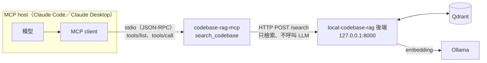

# codebase-rag-mcp

把 [local-codebase-rag](https://github.com/alelcold/local-codebase-rag) 的檢索能力包成 **MCP Server**，提供一個 `search_codebase` tool。接上之後，Claude Code、Claude Desktop 等 MCP host 可以直接查詢遊戲前端專案的程式碼，回答時引用 `檔案:行號`。

> **In English:** an MCP server that exposes local-codebase-rag's retrieval pipeline as one read-only tool, `search_codebase`. The tool returns excerpts with `path:start-end`; the host's model reads them and writes the answer. The server is a thin stdio process that calls the backend's retrieval-only `POST /search` endpoint over HTTP and depends only on the MCP Python SDK. Design records are in [`docs/decisions/`](docs/decisions/), the learning journal in [`docs/learning/`](docs/learning/), next steps in [`docs/roadmap.md`](docs/roadmap.md).

## 目錄

- [為什麼要做](#為什麼要做)
- [架構](#架構)
- [前置條件](#前置條件)
- [安裝與接上 MCP host](#安裝與接上-mcp-host)
- [Tool 規格](#tool-規格)
- [設定](#設定)
- [開發與測試](#開發與測試)
- [文件導覽](#文件導覽)

## 為什麼要做

local-codebase-rag 已經有網頁介面，但回答是由本機的 `qwen2.5-coder` 寫的。做成 MCP Server 之後：

- **回答交給更強的模型**：tool 只回傳取回的程式碼片段，由 host 的模型（例如 Claude）閱讀後回答，不經過第二個模型轉述（[ADR 0001](docs/decisions/0001-retrieval-only-tool-over-http.md)）。
- **在工作流程裡直接用**：在 Claude Code 寫程式時就能問「這個數值在哪裡設定」，不用切到瀏覽器。
- **檢索設定只有一份**：MCP Server 不自己做檢索，`HYBRID_SEARCH`、`SPLIT_RETRIEVAL` 等開關與評估結果完全沿用後端。

## 架構



一次呼叫的流程：

1. Host 啟動 `codebase-rag-mcp` 子行程，透過 stdin/stdout 交換 JSON-RPC 訊息，先 `initialize` 協商能力。
2. Host 呼叫 `tools/list`，取得 `search_codebase` 的名稱、描述與 JSON Schema，放進模型的 context。
3. 模型決定要查時送出 `tools/call`；server 呼叫後端 `POST /search`，把片段整理成 Markdown（給模型讀）與結構化資料（給程式用）回傳（[ADR 0003](docs/decisions/0003-markdown-text-plus-structured-content.md)）。

## 前置條件

1. local-codebase-rag 已啟動並建立索引（`./scripts/setup.sh --index`）。
2. 後端包含 `POST /search` 端點。目前要先套用 [`patches/local-codebase-rag-search-endpoint.patch`](patches/README.md)，之後會合併進 local-codebase-rag。
3. Python 3.11 以上，建議安裝 [uv](https://docs.astral.sh/uv/)。

確認後端可用：

```bash
curl -s http://localhost:8000/search -H 'Content-Type: application/json' \
  -d '{"question": "INVINCIBLE_MS 在哪裡設定", "top_k": 2}'
```

## 安裝與接上 MCP host

```bash
git clone https://github.com/alelcold/codebase-rag-mcp.git
```

```bash
cd codebase-rag-mcp && uv sync --extra dev
```

### Claude Code

在要使用的專案根目錄建立 `.mcp.json`（路徑改成你的 clone 位置）：

```json
{
  "mcpServers": {
    "codebase-rag": {
      "command": "uv",
      "args": ["run", "--directory", "/絕對路徑/codebase-rag-mcp", "codebase-rag-mcp"],
      "env": { "CODEBASE_RAG_URL": "http://localhost:8000" }
    }
  }
}
```

或用指令加入：

```bash
claude mcp add codebase-rag -e CODEBASE_RAG_URL=http://localhost:8000 -- uv run --directory /絕對路徑/codebase-rag-mcp codebase-rag-mcp
```

在 Claude Code 裡輸入 `/mcp` 可以看到連線狀態。

### Claude Desktop

把同樣的 `mcpServers` 區塊加進 `claude_desktop_config.json`，重新啟動 Claude Desktop。

### 用 MCP Inspector 手動測試

```bash
npx @modelcontextprotocol/inspector uv run --directory . codebase-rag-mcp
```

瀏覽器會打開 Inspector，可以看到 `initialize` 的回應、tool 清單，並手動呼叫 `search_codebase`。

## Tool 規格

`search_codebase`（`readOnlyHint: true`、`openWorldHint: false`）

| 參數 | 型別 | 說明 |
| --- | --- | --- |
| `query` | string（1–4000 字） | 自然語言（中文或英文）或識別字，例如 `INVINCIBLE_MS` |
| `top_k` | integer（1–30，選填） | 回傳片段數，預設 `CODEBASE_RAG_TOP_K`（8） |

回傳：

- **text**：每個片段一個標題 `## [1] src/config/gameConfig.ts:3-9 \`INVINCIBLE_MS\``，加上程式碼區塊。
- **structuredContent**：`{query, results: [{ref, location, file_path, start_line, end_line, symbol, kind, language, score, matched_by, truncated, text}]}`，格式由 `outputSchema` 定義。
- 後端連不上、逾時、尚未索引時回傳 `isError: true`，訊息說明原因與修正方式，讓模型能轉告使用者。

## 設定

都在 MCP host 設定的 `env` 區塊裡設定。

| 變數 | 預設 | 說明 |
| --- | --- | --- |
| `CODEBASE_RAG_URL` | `http://localhost:8000` | local-codebase-rag 後端位址 |
| `CODEBASE_RAG_TIMEOUT` | `30` | 等待 `/search` 的秒數（只做 embedding，不需要 LLM 的長逾時） |
| `CODEBASE_RAG_TOP_K` | `8` | 模型沒指定時的片段數 |
| `CODEBASE_RAG_MAX_CHARS` | `4000` | 每個片段最多保留的字元數，控制 tool 結果佔用的 context |

## 開發與測試

```bash
uv run pytest
```

測試不需要後端：MCP 層用 SDK 的記憶體內 `Client` 走完整的 `initialize → tools/list → tools/call`；HTTP client 對一個本機假後端測試。

注意：stdio 模式下 **stdout 專門傳 JSON-RPC**，任何 `print()` 都會破壞協定。記錄請用 `logging`（預設輸出到 stderr）。

## 文件導覽

| 文件 | 內容 |
| --- | --- |
| [`docs/decisions/`](docs/decisions/) | ADR：為什麼這樣設計、考慮過哪些方案 |
| [`docs/devlog/`](docs/devlog/) | 開發日誌：問題 → 原因 → 解法 |
| [`docs/learning/mcp-notes.md`](docs/learning/mcp-notes.md) | MCP 學習筆記與待探討問題 |
| [`docs/roadmap.md`](docs/roadmap.md) | 後續發展階段 |
| [`patches/`](patches/README.md) | 要套用到 local-codebase-rag 的修改 |
